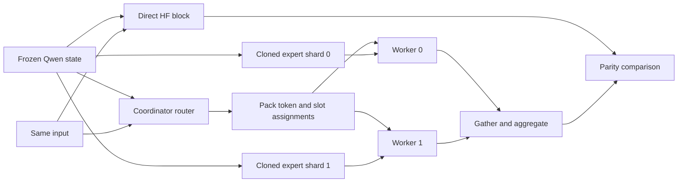

# Issue #1 execution plan: tiny Qwen3 MoE correctness

Prepared 2026-10-16 using the codebase-design skill. This is an implementation
proposal for the existing issue, not a specification amendment or a new issue queue.

- Issue: [#1 — Prove tiny Qwen3 MoE parity across two local worker processes](https://github.com/karlem/spoj/issues/1).
- Authority: [canonical specification](../specs/spoi-v0.1.md) and
  [authorization](local-experiment-approval.md), approved revision
  `e49f36f30312400a45c4d68d4a1db18328e64ef6`.
- Workflow: [factory policy](factory.md). Full benchmark/run-bundle work belongs to
  dependent [issue #2](https://github.com/karlem/spoj/issues/2).
- Intended result: the real Hugging Face block and two persistent workers produce
  numerically equivalent output from the same frozen weights and input, with
  verified expert ownership and bounded failure/cleanup behavior.

## Verified starting point

Main and the existing branch `issue-1` both point to the approved revision.
The worktree `.worktrees/issue-1` already contains untracked `spoi/` work:
`pyproject.toml`, `uv.lock`, and `src/spoi/__init__.py`, plus an ignored environment.
Preserve these files. No coordinator, worker implementation, or product tests
were present during inspection. GitHub #1 is open and unassigned; that alone does
not establish that the local worktree is unowned. The main README's idle status
predates the current issue queue.

The planning observations above are historical. The human subsequently authorized
implementation and GitHub publication. The local writer has stopped; the current
handoff and ownership status are recorded on GitHub issue #1. Continue from the
published `issue-1` branch, preserving the existing implementation.

| Prerequisite | Observed result |
| --- | --- |
| Host | Apple M1 Pro, 10 logical CPUs, 32 GiB RAM, native arm64 |
| OS | macOS 27.0, build 26A428 |
| Environment | uv 0.11.10; task environment Python 3.12.13 |
| Installed and locked packages | torch 2.14.1, transformers 5.20.1, pytest 9.1.1, psutil 7.2.2 |
| Direct reference probe | Real block, eager experts, shape `[1,16,64]`, CPU float32, finite output |
| Available CPU sharing strategy | `file_system` only in this installed runtime |
| Repository check | `./scripts/check.sh` exits 0 but is still the Phase 0 placeholder |

The compatibility probe instantiated only a tiny random-weight block; it did not
download a checkpoint. It is evidence that the installed reference can run, not
worker parity, clean-environment reproducibility, or benchmark evidence. Its one
unwarmed call was 15,161,833 ns; do not use this as a latency comparison.
The imported `modeling_qwen3_moe.py` SHA-256 was
`58387f2cc22a706e7e4c7dabe6cf05cb1e9c9fe48c57e2f2a0fc5cbdb2132f4f`.

## Design: small interfaces with concentrated responsibilities

Use ordinary Python modules and typed records. The real variation is between
direct HF execution and execution across processes. Avoid transport plugins,
generic executors, registries, or a distributed framework for this experiment.



| Module | Proposed interface and hidden implementation |
| --- | --- |
| `config.py` | Validated `ExperimentConfig`: dimensions, experts/top-k, renormalization, seed, exactly two partitions, thread and timeout settings. Reject invalid values before allocation/spawn. |
| `qwen3_adapter.py` | Build the initialized reference; freeze/hash state; obtain routing; extract owned expert shards; evaluate shard assignments. All HF imports, internal names, backend checks, tensor layouts, and local expert math stay here. |
| `partition.py` | Pure ownership, packing, and aggregation functions. Carry each selected `(token_index, top_k_slot)` exactly once; validate coverage and reconstruct the original shape. |
| `coordinator.py` | Context-managed `ExpertSession` exposing `forward(x) -> ForwardResult`. Own spawn, readiness, bounded transport, identities, deadlines, failure propagation, and teardown behind this interface. |
| `worker.py` | Private module-level spawn entry point. Receive one shard, verify it, execute assignments, return weighted rows and local compute duration. |
| `baseline.py` | Small direct-reference helper using `block(x)` under inference mode. Preserve the independent numerical oracle. |
| `__main__.py` | Guarded CLI with `smoke`; parsing and result presentation only. |

These responsibilities may use several private functions; they do not require
one class per file. In particular, do not expose queues, processes, or HF parameter
names to CLI callers. The worker entry point is an internal seam for controlled
failure tests. No production fault-injection flags are needed.

Proposed caller shape:

```python
reference, frozen_state = build_reference(config)
with ExpertSession(config, frozen_state) as session:
    result = session.forward(x)
    expected = baseline(reference, x)
    assert_close(result.output, expected)
```

`ForwardResult` contains the output, request identity, per-worker assignment
counts, and worker compute durations. Keep metadata separate from the output
tensor. One request is in flight at a time; concurrent calls are unsupported and
must be rejected. A failed session becomes unusable and closes its children.
This keeps the interface small while preserving what issue #2 needs.

## Installed Qwen contract

The installed package, rather than upstream `main`, is the implementation target.
Inspection of its Qwen module and `transformers/integrations/moe.py` established:

| State key | General shape | Default shape |
| --- | --- | --- |
| `gate.weight` | `[E,H]` | `[4,64]` |
| `experts.gate_up_proj` | `[E,2I,H]` | `[4,256,64]` |
| `experts.down_proj` | `[E,H,I]` | `[4,64,128]` |

Construct `Qwen3MoeConfig` with the spec's tiny dimensions, SiLU, top-k and
renormalization settings, and `experts_implementation="eager"`. Instantiate only
`Qwen3MoeSparseMoeBlock`, call `eval()`, and explicitly use CPU float32.
Assert `block.experts.config._experts_implementation == "eager"` before execution.
Selecting an attention backend does not select the expert backend.

The expert constructor uses uninitialized tensors and the router starts at zero.
Seed Python and Torch, then explicitly initialize every named parameter in a
stable sorted-name order with normal values using `config.initializer_range`.
Do this once; workers never initialize replacement weights. Disable gradients
and run baseline and workers inside `torch.inference_mode()`.

`block.gate(flat_x)` returns `(logits, selected_weights, selected_expert_ids)`.
Use that real router in the coordinator. Its scores come from float32 softmax,
top-k selection, optional renormalization, and a cast to logits dtype.
The direct `block(x)` returns a tensor, not the older output/router tuple.

For each owned expert, the adapter uses the cloned fused gate/up weight, splits
its linear output into gate/up halves, applies `silu(gate) * up`, performs the
down projection, and multiplies by the corresponding selected routing weight.
Return one weighted row per assignment. Preserve output dtype and use additive
aggregation for repeated token indices. Keep this version-specific math inside
the adapter; no independently initialized `nn.Linear` substitutes.

Fail before spawning if package compatibility, exact state keys/shapes,
CPU/float32 dtype, finite values, or eager-backend expectations differ. Record
actual versions and source fingerprint in evidence. Recheck this contract after
any lockfile change; do not silently support another layout.

## Frozen state and ownership

Snapshot with detached CPU clones: `state_dict()` alone is not an immutable copy.
Treat snapshot tensors as read-only and never expose mutable references to callers.
Define a canonical hash format with a version tag, sorted tensor names,
length-delimited UTF-8 name/dtype/shape metadata, and contiguous little-endian
float32 value bytes. Hash those bytes with SHA-256; avoid incidental pickle/archive
metadata. Test hash reproducibility and sensitivity to changed values.

Default ownership is `{0:0, 1:0, 2:1, 3:1}`. For other expert counts, split ordered
IDs into contiguous halves with the first receiving the extra expert. Exactly
two partitions remain; `E=1, top_k=1` permits an empty second partition because
the spec does not require two nonempty partitions. Validate explicit placements
for missing IDs, duplicates, invalid IDs, and invalid worker IDs.

Clone selected tensors into compact contiguous storage before passing a shard
to a child. A contiguous view can still retain the full bank: the local probe
measured 262,144 storage bytes for both the default gate/up bank and its first-half
view, versus 131,072 bytes for the cloned half. Test storage byte counts as well
as logical shapes. Never pass the reference block, whole snapshot, or a bound
method capturing either as a process argument.

Each shard carries global expert IDs, local ID mapping, the whole-state hash as
provenance, and an expected shard digest. A worker recomputes its shard digest
from received values before acknowledging readiness. The coordinator compares
against its own expected digest. Whole-state hash equality alone cannot prove
that the worker received correct slices. Altering a selected expert must fail
the integrity check; a separate controlled test should expose parity failure if
corrupt weights are evaluated despite that check.

## Process protocol and failure behavior

Use `torch.multiprocessing.get_context("spawn")`, two long-lived processes,
per-worker `Queue(maxsize=1)`, and a shared bounded response queue (proposed size
4). Set Torch intra-op/inter-op threads to 1 at process initialization, before
numerical work. Keep the CLI entry guarded and the worker entry pickleable.

Proposed messages are plain typed records:

- `Ready(run_id, worker_id, pid, expert_ids, shard_digest, storage_bytes)`.
- `Execute(run_id, request_id, worker_id, rows, token_indices, slot_indices,
  expert_ids, routing_weights)`.
- `Result(run_id, request_id, worker_id, token_indices, slot_indices,
  weighted_outputs, compute_ns)`.
- `Error(run_id, request_id_or_none, worker_id, error_type, message, traceback)`.
- `Stop(run_id)` and a shutdown acknowledgement.

Startup has a separate deadline from inference. Proposed defaults: startup 60 s,
request 10 s, shutdown grace 5 s, followed by bounded termination/reaping. These
are configurable implementation defaults, not performance acceptance thresholds.
One monotonic request deadline covers both queue puts and all response waits.
Poll child exit status during bounded waits so a crash is distinguished from a
slow response. Do not use queue `empty()` or `qsize()` as synchronization.

For an input `[B,S,H]`, flatten to `T=B*S` rows. Track all `T*K` assignments with
their original token/slot IDs. Pack only rows selected for the owning worker;
duplicating a row for multiple assignments is acceptable at this scale. Send an
empty request to a zero-hit worker and require an empty result. This makes two
replies, participation accounting, and deadlines consistent.

Validate run/request/worker IDs, duplicate replies, returned assignment coverage,
shapes, dtype, and finite outputs before accepting a response. Receive in any
order, then aggregate in a fixed worker/assignment order to reduce numerical
variation. A mismatched reply fails the run; do not discard it and silently wait.

On every exit path, including partial startup, stop/join children in `finally`,
escalating to terminate/kill only for this session's surviving children and
reaping them. Normal shutdown drains replies before joining producers. After
abnormal termination, discard potentially corrupted queues and bound feeder
cleanup; never hang indefinitely in `join_thread()`. Release tensor references
and close channels. Exercise this on native macOS, including the `file_system`
sharing manager, rather than assuming Linux shared-memory behavior.

## Implementation sequence and evidence gates

These are stages inside issue #1, not additional tickets.

1. **Resume safely and establish the environment.** Verify no active writer owns
   `.worktrees/issue-1`; record owner, actual model/harness, attempt, branch, base,
   spec revision, and evidence paths. Retain and inspect the existing scaffold.
   Preserve the locked versions unless a demonstrated incompatibility requires
   a documented remedy. Verify editable installation resolves this worktree's
   `src/spoi`. Make `scripts/check.sh` exercise the product tests.
2. **Implement the guarded reference and frozen state.** Convert the verified
   contract above into adapter/config code. Prove deterministic initialization,
   finite direct outputs, exact schema/backend checks, canonical hash, and
   compact shard ownership. Stop here on HF incompatibility.
3. **Prove dispatch math without processes.** Run the actual shard evaluator in
   process through packing/aggregation. Match the HF oracle and verify assignment
   multiplicity. This isolates arithmetic/layout mistakes from transport bugs;
   it does not satisfy the two-process acceptance criterion.
4. **Add the persistent process session.** Implement readiness, IDs, bounded
   queues/deadlines, replies, and teardown. Demonstrate several requests using
   the same two worker PIDs and disjoint stored expert IDs. Retain worker-local
   compute durations for later measurement.
5. **Complete adversarial tests and smoke.** Cover the matrix below, validate in
   a fresh frozen environment, and capture process/resource cleanup evidence.
   Smoke prints versions/backend, seed/config, shape/dtype, state hash, ownership,
   participation, and maximum absolute/relative error; exit nonzero on failure.
6. **Freeze and independently review.** Freeze an implementation commit with
   commands, exit codes, and artifacts. Request strong independent review of
   numerical fidelity, shard storage, queue failure paths, and evidence. Transfer
   sole writer ownership for fixes, repeat affected checks/review, then present a
   merge-ready result. Human merge authority remains required.

Architecture and process-lifecycle work warrant a frontier worker and strong
review under the factory policy. A bounded test or documentation assignment may
use a proven cheaper model only after the interface is fixed and writer ownership
is transferred. Record concrete model IDs when assigning; none are invented here.
After two failed implementation/fix attempts, escalate through the manager.

## Validation matrix

| Area | Required test and expected evidence |
| --- | --- |
| Config | Reject nonpositive dimensions/expert counts, invalid top-k, non-two partitions, invalid placements/timeouts; support valid one-expert/empty-partition case. |
| Reference | Fixed seed reproduces weights/hash/output; changed seed changes state; all state is initialized, finite, CPU float32; incompatible schema/backend/version fails before spawn. |
| Numerical parity | Shapes `[1,16,64]`, `[1,128,64]`, `[8,128,64]`; seeds 0 and 1; top-k 1/2; renormalization on/off; expert counts 4 and 5. Proposed full matrix: 48 scenarios, each comparing the actual process path with direct HF output. |
| Routing and assignment | Compare router indices/weights, prove each token/slot contributes once, exercise the same token sent to both workers and multiple experts on one worker. |
| Controlled hit coverage | Before freezing, choose known router weights and input directions with distinct logits to force both-worker hits and a zero-hit worker (test each side). Run both paths from that same modified snapshot; avoid relying on random luck or tied logits. |
| Slice integrity | Match expected shard values/digests and compact backing-storage sizes; changed weights cause rejection; verify baseline snapshot is unaffected by shard mutation. |
| Lifecycle | Same two PIDs across repeated calls; normal/exceptional exit, partial startup failure, worker traceback, hard crash, hung request, queue backpressure, wrong/stale IDs, duplicate/malformed replies, and idempotent close. |
| Resource cleanup | Run lifecycle scenarios in bounded subprocesses. Record child/descendant PIDs and verify exit, inspect resource-tracker warnings, and verify named resources attributable to the run are released after sharing-manager grace. No destructive cleanup of unrelated resources. |
| Reproducibility | Fresh venv from the unchanged lock, offline-HF smoke, exact runtime/import location, and retained stdout/stderr/exit codes. |

Use `torch.testing.assert_close(rtol=1e-5, atol=1e-6)` initially. Report maximum
absolute error and maximum relative error with the denominator convention stated
(proposed `max(abs(reference), 1e-12)`). The allclose assertion is the pass/fail
criterion; a large relative error near zero alone is not a failure. Investigate
any tolerance change with element-level evidence and reduction-order analysis.

Commands from the issue worktree root after implementation:

```sh
uv sync --project spoi --frozen
./scripts/check.sh
uv run --project spoi --frozen pytest spoi/tests -q
HF_HUB_OFFLINE=1 TRANSFORMERS_OFFLINE=1 uv run --project spoi --frozen python -m spoi smoke
```

For fresh-environment evidence, choose a unique, absent environment path and use
it for both commands; retain it rather than deleting another environment:

```sh
UV_PROJECT_ENVIRONMENT="$PWD/target/spoi/validation/issue-1-fresh-<unique-id>" uv sync --project spoi --frozen
UV_PROJECT_ENVIRONMENT="$PWD/target/spoi/validation/issue-1-fresh-<unique-id>" HF_HUB_OFFLINE=1 TRANSFORMERS_OFFLINE=1 uv run --project spoi --frozen python -m spoi smoke
```

Replace `<unique-id>` consistently before execution. Package installation may
need registry access; HF offline flags prevent model-hub use during the smoke.
Do not claim fresh-environment success from the currently installed environment.

## Scope, readiness, and handoff

Keep the tiny CPU workload within the canonical 4–8 GB experiment budget; the
host's 32 GiB is not permission to enlarge the workload. Full memory diagnostics,
pressure/swap abort monitoring, paired benchmark sampling, summaries, and atomic
run bundles remain assigned to issue #2. Preserve PIDs, worker participation,
compute durations, and the timing seam needed for that work. Issue #1 evidence
does not establish completion of v0.1 or a multi-device capacity demonstration.

The initial two-process smoke has now passed on native macOS: two requests,
zero maximum absolute/relative error, and both worker exit codes zero. The full
parity/failure/resource suite, fresh frozen environment, and independent review
remain outstanding. GitHub issue #1 records the continuation checklist. A cloud
run is supplementary evidence; native Mac acceptance remains required by the spec.

Deliver code/lockfile/README, a frozen implementation commit, test and smoke
transcripts, compatibility and ownership evidence, and independent review findings
with their resolutions. Append actual implementation/review attempt records under
`.factory/README.md`; this planning session is not a completed implementation
attempt. Record final status under the factory definitions; `DONE` means reviewed
and merge-ready, not merged. Issue #2 starts only after its required reviewed
correctness artifact is available and verified.

## Research references

The installed sources inspected were under
`.worktrees/issue-1/spoi/.venv/lib/python3.12/site-packages/`: Qwen's
`modeling_qwen3_moe.py`, `configuration_qwen3_moe.py`,
`transformers/configuration_utils.py`, and `transformers/integrations/moe.py`.
These local 5.20.1 files and the runtime probe establish the exact contract above.
The upstream tagged source could not be fetched through web research, so no
tag-to-installed-source equivalence is claimed.

- [Qwen3 MoE upstream source](https://github.com/huggingface/transformers/blob/main/src/transformers/models/qwen3_moe/modeling_qwen3_moe.py): architectural context; moving `main` is not the lock contract.
- [PyTorch multiprocessing practices](https://docs.pytorch.org/docs/2.12/notes/multiprocessing.html): background-thread hazards, guarded entry points, thread limits, and tensor queue copies.
- [PyTorch sharing strategies](https://docs.pytorch.org/docs/2.12/multiprocessing.html#sharing-strategies): macOS lacks `file_descriptor` support; `file_system` uses a cleanup manager. Confirmed against the installed runtime's available strategies.
- [PyTorch serialization semantics](https://docs.pytorch.org/docs/2.12/notes/serialization.html): tensor views retain storage; cloning separates it. The planning probe directly confirmed the storage-size difference.
- [Python 3.12 multiprocessing](https://docs.python.org/3.12/library/multiprocessing.html): queue feeder lifecycle, process start contexts, and termination hazards inform the bounded shutdown design.
- [uv locking and syncing](https://docs.astral.sh/uv/concepts/projects/sync/): frozen synchronization uses the existing lock; verify freshness separately and preserve the lock during validation.

Web PyTorch references above are version 2.12 guidance; installed behavior must
be checked on the locked 2.14.1 runtime. No library upgrade is proposed by this plan.
