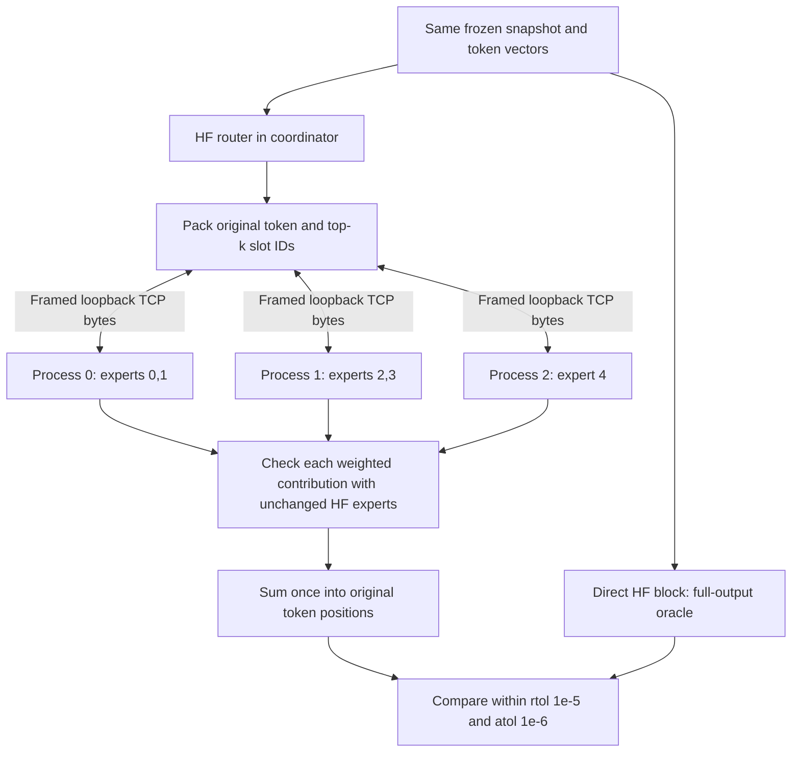

# Local TCP MoE: an inspectable correctness argument

This milestone distributes one tiny random-weight Qwen3 MoE block over three local worker processes. The coordinator retains a full reference for checking; this does not show reduced total memory, full-model generation, performance improvement, or multiple machines. Original native Mac acceptance remains separate.

## Why independent expert work can cross this boundary

For token t, the actual HF router supplies expert IDs e(t,s) and weights w(t,s) for top-k slots s. The output is the sum of w(t,s) * expert_e(t,s)(x[t]). After routing, each contribution depends only on the token row, its selected weight and the chosen expert tensors. A worker can evaluate that contribution with its owned expert shard. Preserving every token/slot exactly once preserves the sum, subject to the existing float32 tolerance. The tests establish that this implementation follows the contract; this algebra alone does not prove the transport or code.



This diagram explains the architecture. The artifact's generated frame diagram and token table come from measured I/O instead.

## Follow one request through the code

1. **Freeze provenance.** `qwen3_adapter.build_reference` initializes real HF tensors explicitly in sorted name order. `FrozenState` clones and hashes them. The demo deliberately replaces only router weights to force unambiguous selected experts, then freezes a new snapshot shared by both reference and distributed paths. Exact source/version/backend/schema guards remain enforced. Installed raw source excerpts are included with the evidence; PyTorch's compiled kernels are not independently audited.
2. **Transmit owned weights.** `TCPSession.__enter__` starts independent Python subprocesses with only port/run/worker arguments. It sends the compact gate/up and down tensors over the TCP connection. `tcp_worker.serve` reconstructs local tensors and validates dimensions, IDs, finite dtype, compact storage and digest before ready. Ready contains the hash of the exact received initialization frame. There is no tensor passed via spawn arguments, shared memory, file path or pickle on this path.
3. **Preserve the assignment domain.** `TCPSession.forward` compares frozen-router logits, selected IDs and weights to the actual reference router. `partition.pack` groups (token, slot) pairs by static owner. The coordinator checks that their union is exactly all selected pairs, with no duplicates. A top-k two token visits at most two experts; all three workers participate across the demonstration batch. Explicit empty requests/replies account for zero-hit workers.
4. **Compute and check independent contributions.** The worker's `evaluate_shard` returns one weighted vector for every assignment. The coordinator uses `block.experts(rows, expert_ids[:,None], weights[:,None])` as a separate oracle. This is the unchanged installed HF expert implementation with one selected choice per assignment row; it does not call the custom shard evaluator. Returned IDs/weights/shape/dtype and each contribution must match, before any final-output comparison.
5. **Reconstruct and close.** `partition.aggregate` adds each returned vector to its original token using `index_add_`. The coordinator compares both the HF contribution sum and worker sum with direct `block(x)`. One request deadline bounds socket I/O across fragments and workers. Shutdown acknowledges stop, closes sockets and reaps children with bounded terminate/kill escalation. Normal completion rejects malformed acknowledgements/nonzero exits; cleanup after a prior failure preserves the original error.

## The byte contract

`tcp_wire` uses an eight-byte network-order prefix: metadata byte count and tensor payload byte count. Metadata is versioned JSON; tensors are contiguous little-endian float32 or int64 bytes with explicit shapes/offsets. Maximum header 64 KiB; payload 8 MiB. Receive validates lengths before reading payload and validates descriptors before tensor construction. Duplicate JSON fields, unsupported types, nonfinite values, extra bytes and inconsistent offsets/shapes fail. Send/receive loops handle short operations under one absolute monotonic deadline; progress does not reset it.

The trace includes full base64 frames, hashes/byte counts, endpoints, request IDs, frozen state/shard hashes, input/router vectors, weighted results and oracle values. Worker results acknowledge the exact request-frame hash. Trace requests, dimensions, event count and total raw bytes have explicit caps; excess fails rather than truncating claimed evidence.

## What each kind of evidence establishes

| Evidence | Supported claim | Limit |
| --- | --- | --- |
| Frozen source/build and snapshot hashes | Specific installed contract and shared weight provenance | Does not independently audit compiled Torch kernels |
| Controlled routes and token/slot bijection | Ownership, all-worker and zero-hit cases, no missing/duplicate assignment | Selected scenarios do not exhaust every numerical input |
| Actual HF contribution checks | Custom owned expert math agrees before reconstruction | HF and custom path share PyTorch primitives |
| Direct HF block output | End-to-end numerical parity on tested inputs | No speedup/capacity implication |
| Raw frame decode and worker receipt hashes | Byte contents, framing and linkage to returned results | Hashes are not signatures or proof against a malicious artifact producer |
| Kernel backpressure, fragmented/invalid frames and worker faults | Intended failures are rejected within bounded operations | No public network/authentication/TLS or cross-host evidence |
| Standalone artifact replay | A reader can recompute invariants and HF values without trusting the summary | It cannot independently observe historical process execution |
| Independent source review and regression suite | External-to-writer inspection plus reproducible checks | Not external human review or native Mac acceptance |

The generated measured walkthrough, raw frames and executed commands are published alongside the evaluated commit. Check their exact exit codes; the interrupted pre-fix suite is explicitly not a pass.

## Lifecycle limitation made visible by testing

The local worker bounds its idle read using `startup_timeout` (60 seconds by default). Keep a session within its intended scoped use; this is not a general-purpose indefinitely idle worker service. The earlier full suite retained its last module fixture through unrelated fault tests, exceeded that limit and correctly failed normal teardown. Moving that fixture into the parity-test class fixes the test lifetime without extending or bypassing the worker deadline. The failed transcript remains part of the evidence.

Here, a token is one position containing a synthetic 64-number hidden-state vector. The measured demo uses three such positions, five real HF expert weight sets initialized randomly, and a deliberately controlled router. It exercises a MoE block; it does not tokenize text or generate language. The seeded matrix separately exercises the unmodified seeded router.

Expert placement stays fixed throughout a session: expert 4 always belongs to worker 2 in this demo. The HF router chooses top-k experts separately for each token vector. Shard weights cross TCP once during initialization; subsequent requests carry selected hidden-state rows, token/slot identities, expert IDs and routing scores. Replies contain weighted contribution vectors. The coordinator keeps router weights and the full baseline snapshot for validation.

## Evaluated artifact and actual outcomes

Evaluated code `1193fcf8733ae73bde4ff3f18fdaf2c5c61932d7`; frozen full suite **272 passed**, zero skipped/failures/errors, exit 0. Fresh frozen sync, three-worker demo and offline replay each exited 0. Four falsified-artifact commands each exited 1 as required; their harness exited 0. Independent source review found and verified correction of one shutdown-protocol gap; the fixture-lifetime failure and interrupted run remain included.

Start with the [generated measured walkthrough](../evidence/local-tcp-1193fcf/README.md), then inspect the [raw trace](../evidence/local-tcp-1193fcf/trace.json), [verification](../evidence/local-tcp-1193fcf/verification.json), [named full-suite transcript](../evidence/local-tcp-1193fcf/full-check.log), [JUnit outcomes](../evidence/local-tcp-1193fcf/final-junit.xml), [raw installed source excerpts](../evidence/local-tcp-1193fcf/installed-source.txt) and [negative-command outcomes](../evidence/local-tcp-1193fcf/negative-results.json). The [manifest](../evidence/local-tcp-1193fcf/manifest.json) identifies evaluated code and earlier non-passing runs. SHA-256 file checksums detect artifact changes; they do not authenticate a producer.

### One measured token, followed numerically

Request 1, token position 0 has value 2 in component 0 and value 1 in component 2; all other 62 components are zero. Its controlled router logits are [8.0, 0.0, 4.0, 0.0, 0.0].

| Slot | Expert | Worker | Measured routing weight | Weighted output component 0 |
| --- | --- | --- | --- | --- |
| 0 | 0 | 0 | 0.982013762 | 2.5987801564e-05 |
| 1 | 2 | 1 | 0.01798621006 | 5.24413917447e-06 |

The received vectors sum to output component 0 = `3.12319389195e-05`, identical to direct HF here. All 64 components and both HF contribution vectors are retained, not only this displayed component. Request 1/2 cover all three workers across the batch; request 3 routes only to worker 0 while workers 1/2 explicitly reply with empty contributions. The raw transcript contains 33 frames and 14 contributions over three requests; maximum absolute error 0.0.

### Source entry points at the evaluated commit

- [Frozen state, exact guards and expert arithmetic](https://github.com/karlem/spoj/blob/1193fcf8733ae73bde4ff3f18fdaf2c5c61932d7/spoi/src/spoi/qwen3_adapter.py)
- [Assignment packing and reconstruction](https://github.com/karlem/spoj/blob/1193fcf8733ae73bde4ff3f18fdaf2c5c61932d7/spoi/src/spoi/partition.py)
- [Framing and absolute-deadline I/O](https://github.com/karlem/spoj/blob/1193fcf8733ae73bde4ff3f18fdaf2c5c61932d7/spoi/src/spoi/tcp_wire.py)
- [Standalone owned-shard execution](https://github.com/karlem/spoj/blob/1193fcf8733ae73bde4ff3f18fdaf2c5c61932d7/spoi/src/spoi/tcp_worker.py)
- [Ownership, HF contribution checks and lifecycle](https://github.com/karlem/spoj/blob/1193fcf8733ae73bde4ff3f18fdaf2c5c61932d7/spoi/src/spoi/tcp_session.py)
- [Controlled measured demonstration](https://github.com/karlem/spoj/blob/1193fcf8733ae73bde4ff3f18fdaf2c5c61932d7/spoi/src/spoi/tcp_demo.py)
- [Independent raw-frame reconstruction](https://github.com/karlem/spoj/blob/1193fcf8733ae73bde4ff3f18fdaf2c5c61932d7/spoi/src/spoi/verify_tcp_trace.py)

### Reproduce and inspect

```sh
uv sync --project spoi --frozen --python 3.12
HF_HUB_OFFLINE=1 TRANSFORMERS_OFFLINE=1 uv run --project spoi --frozen python -m spoi tcp-demo --output target/tcp/new-demo
HF_HUB_OFFLINE=1 TRANSFORMERS_OFFLINE=1 uv run --project spoi --frozen python -m spoi.verify_tcp_trace docs/evidence/local-tcp-1193fcf/trace.json
HF_HUB_OFFLINE=1 TRANSFORMERS_OFFLINE=1 uv run --project spoi --frozen python docs/evidence/local-tcp-1193fcf/negative_cli.py docs/evidence/local-tcp-1193fcf/trace.json target/tcp/new-negative-checks
./scripts/check.sh
```

Use absent output directories. The original run used `UV_CACHE_DIR=/workspace/.cache/uv` because the host default cache was read-only, and a newly created `UV_PROJECT_ENVIRONMENT=/workspace/spoj/target/tcp/fresh-1193fcf` for frozen sync/demo/replay. Set corresponding writable paths on another Linux environment. Python source was unchanged from the evaluated code during these checks; later documentation/evidence commits do not change implementation.

## Questions for the later multi-machine planning stage

Now that the local correctness argument has passed its checks, planning can ask: which existing devices and OS/CPU combinations are available; their usable per-host memory budgets; how shards load without a full-bank intermediary; where routers and other model components reside; measured payload/link requirements; authentication/encryption and deployment/endpoint discovery; and the cross-host parity/failure evidence needed. This is a list of planning inputs, not a multi-host implementation or provisioning authorization. Native Mac full/fresh acceptance for the original experiment remains outstanding.

Independent review and actually executed replay: [final review record](../evidence/local-tcp-1193fcf/final-review.md). The [backpressure witness](../evidence/local-tcp-1193fcf/backpressure.json) recorded 65,482 successfully sent TCP bytes over three send calls before the absolute 0.2-second deadline timed out while the peer was not reading; this is a functional bound check, not a performance result.
