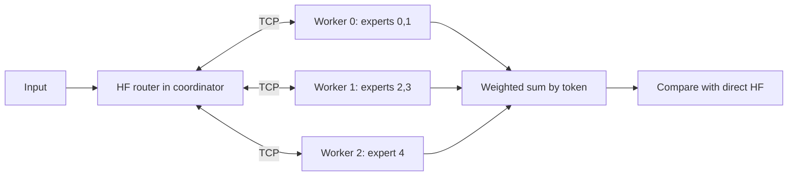
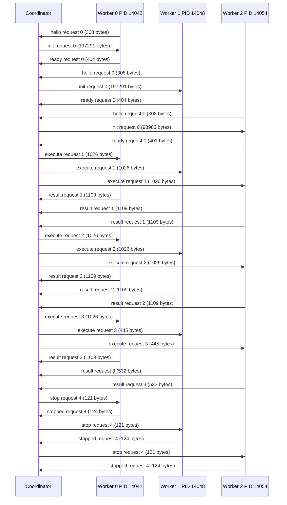

# Measured local TCP walkthrough

This table is generated from request 1 in trace.json, not invented example data.
Full token/input/router/output vectors and base64 raw frames are retained there.
Workers receive no shard tensor through process launch; only loopback port and IDs.

## Explanatory architecture (not a measured diagram)

## Observed request 1 contributions

| Token | Slot | Expert | Worker | Routing weight | First output component |
| --- | --- | --- | --- | --- | --- |
| 0 | 0 | 0 | 0 | 0.98201376 | 2.59878016e-05 |
| 1 | 0 | 1 | 0 | 0.98201376 | 0.000112822701 |
| 0 | 1 | 2 | 1 | 0.01798621 | 5.24413917e-06 |
| 2 | 0 | 2 | 1 | 0.98201376 | -0.000200280556 |
| 1 | 1 | 4 | 2 | 0.01798621 | -5.10693053e-06 |
| 2 | 1 | 4 | 2 | 0.01798621 | -2.52772963e-07 |

Each row is one token/top-k-slot assignment. The worker returns its weighted
expert vector. The coordinator checks it against the unchanged HF experts path,
then adds contributions by token and compares to direct block(x).
Request 2 repeats the same input/PIDs. Request 3 routes only to worker 0;
workers 1/2 return explicit zero-length contributions over TCP.

## Observed frames (generated from recorded I/O)

The full encoded frame hashes/bytes appear in trace.json. Worker readiness
attests the received initialization frame hash; results attest the received
request frame hash. verify_tcp_trace decodes these raw frames, rebuilds the
snapshot from transmitted shards plus router weights, checks snapshot/shard
hashes, re-executes real HF contributions and direct outputs, and checks the
walkthrough records against the bytes. SHA-256 links evidence; it is not a
signature or proof against a malicious producer. PIDs/endpoints show local
execution context; these data do not prove remote execution.

## Source map

- qwen3_adapter.py: locked HF source/version guard, frozen hash and custom expert math.
- partition.py: token/slot-preserving packing and indexed accumulation.
- tcp_wire.py: bounded JSON metadata and raw little-endian tensors, partial I/O, absolute deadlines.
- tcp_worker.py: standalone process, initialization digest, owned expert loop.
- tcp_session.py: launch/readiness/ownership, real socket frames, HF contribution and final checks, cleanup.
- tcp_demo.py: controlled routing, repeat/zero-hit requests and this measured report.
- verify_tcp_trace.py: offline byte decoder and independent HF reconstruction of the artifact.

## What this establishes and leaves open

This run establishes local CPU float32 contribution/output parity for its
recorded inputs through a three-worker TCP boundary. Fault and matrix tests
provide separate broader evidence. It does not establish performance, reduced
total memory, a full language model, native Mac acceptance or multiple hosts.
The coordinator retains the full reference snapshot for checking.

Only after local validation/review passes, later multi-host planning must answer:
which existing hosts/architectures are available, their usable memory budgets,
where weights/router/non-expert state reside, expected wire sizes/link behavior,
authentication/encryption and deployment/endpoint discovery, and what reproducible
cross-host parity/failure evidence is required. No hosts are provisioned here.
