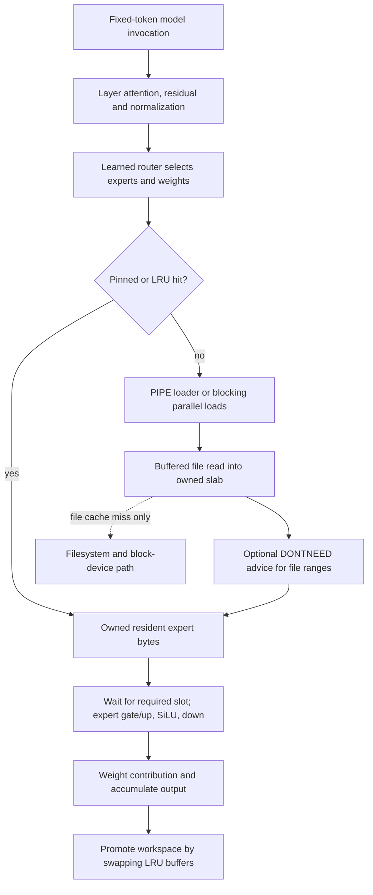

# Decision: test page-cache retention before changing the OS

2026-10-18 · issue [#7](https://github.com/karlem/spoj/issues/7) · research only.

**Pursue one existing upstream configuration experiment, provisionally.** No
SPOJ advantage is established. Do not implement a new allocator, kernel bypass,
OS, or expert-cache controller on this evidence. The physical A/B is **BLOCKED**:
there is no permitted compatible checkpoint in the accessible workspace, and no
usable model-sized storage testbed here. This packet completes the requested
primary-source/bounds fallback; it is not a completed inference experiment.

The question is precise: **after streamed expert weights have been copied into
Colibri's owned RAM cache, does advising away the corresponding file-cache
pages reduce memory pressure enough to repay lost file-cache reuse?** This could
matter when a model fits storage but not RAM, which matches SPOJ's capacity goal.
It could also lose badly. Keeping the file cache provides another reuse tier.

## What exists in SPOJ

[The fresh branch snapshot](evidence/repo-snapshot.json) shows stacked draft PRs
[#3](https://github.com/karlem/spoj/pull/3), [#6](https://github.com/karlem/spoj/pull/6)
and [#8](https://github.com/karlem/spoj/pull/8). `main` is still bootstrap. The
Python project proves a tiny frozen float32 Hugging Face Qwen3 MoE block across
worker processes, then three loopback TCP workers. It has no streamed trained
checkpoint path to optimize. Research simulations are separate from that proof.

A fresh [replay](evidence/tcp-replay.json) checks the historical transcript:
33 frames, 14 contributions, three requests, zero observed absolute error.
That establishes transcript consistency and the bounded HF numerical contract;
it is neither a fresh socket execution nor storage/performance evidence.
The [eleven-skill assessment](skills-review.md) maps current strengths and gaps.
The native Mac acceptance gate remains outstanding.

## Chosen case and strongest baseline

One engine: **JustVugg/colibri at
`e0db083cdc9e563e0766cc6fc661ef23c32298e0`**. One proposed representation:
**GLM-5.2 Colibri int4-g64 routed experts, float32 group scales**, with the
container's other tensors unchanged. The pinned
[recommended artifact](https://github.com/JustVugg/colibri/blob/e0db083cdc9e563e0766cc6fc661ef23c32298e0/README.md#L572)
is `mastouri/GLM-5.2-colibri-int4-g64-with-int8-mtp`; upstream describes it as
429 GB. That is an upstream size/quality statement, not our measurement. No
checkpoint revision, tensor header, dimension, content hash or quality result
has been verified here. Older per-row int4 is not silently substituted.

One proposed workload: a single-stream, batch-one fixed-token decode replay
after one fixed code-explanation prompt. The [protocol](protocol.md) freezes
token IDs before comparisons, uses 64 forced steps, and includes initialization
and warm reuse. It does not assert useful assistant quality from this one task.
One platform class: Linux x86_64 CPU execution with local file-backed storage
and constrained RAM. No Mac/GPU/remote-machine extrapolation is intended.

The strongest baseline is **the best applicable quality-preserving upstream
configuration on that artifact and workload**, not this engine's defaults. Read
[actual tuner candidates](https://github.com/JustVugg/colibri/blob/e0db083cdc9e563e0766cc6fc661ef23c32298e0/c/autotune.py#L174)
and [cache-budget candidates](https://github.com/JustVugg/colibri/blob/e0db083cdc9e563e0766cc6fc661ef23c32298e0/c/autotune.py#L242):
threads, NUMA where relevant, `DIRECT`, `PIPE`, and 75%/50% expert-cache budgets
already exist. Mmap and Linux io_uring also exist, though that tuner does not
exhaust their combinations. Qualify applicable configurations before freezing
a winner. Preserve fixed routing and quantization; cache-aware rerouting is a
different quality contract and is excluded.

The native [replay loop](https://github.com/JustVugg/colibri/blob/e0db083cdc9e563e0766cc6fc661ef23c32298e0/c/colibri.c#L9456)
discards logits: fixed token inputs are **not** a numerical-parity check. Also,
`autotune.create_replay` generates a calibration continuation and its GLM runner
sets `REF_FORCE=1`. Neither action was run. Under the current no-generation and
no-guard-bypass constraints, use the inspected candidate logic with a separately
supplied valid fixed oracle; do not run that calibration or set `REF_FORCE`.
The upstream HF oracle builder is for a tiny random fixture, not this trained
g64 container. The missing independent same-container oracle is an explicit gate.

If mmap or direct I/O wins, **do not force buffered reads to make this experiment
look useful**. Report the winning configuration and reject the duplicate-buffered
weight-cache hypothesis for that case. If buffered io_uring wins, follow its
actual completion path, which already applies `DROP` per read range.

## Source execution path and byte ownership

All links below pin the same engine revision; [sizes and SHA256s](evidence/engine-sources.json)
make the inspected files recoverable. This is a **source-derived illustration**,
not a measured timeline:



| Boundary | Actual implementation and implication |
| --- | --- |
| Invocation → expert demand | `layers_forward`/`layer_forward_rows` at [7638/7413](https://github.com/JustVugg/colibri/blob/e0db083cdc9e563e0766cc6fc661ef23c32298e0/c/colibri.c#L7413); `moe` at 5739; pin/LRU lookup at 6210. Expert IDs and routing weights are model decisions, not I/O-policy decisions. |
| Miss → storage request | [6304–6315](https://github.com/JustVugg/colibri/blob/e0db083cdc9e563e0766cc6fc661ef23c32298e0/c/colibri.c#L6304) dispatches PIPE loads or parallel blocking loads. Distinct workspace slots keep in-flight ownership separate. |
| File → owned memory | `expert_load_impl`, [3170–3284](https://github.com/JustVugg/colibri/blob/e0db083cdc9e563e0766cc6fc661ef23c32298e0/c/colibri.c#L3170): aligned anonymous weight/scale slabs; contiguous same-file weights use one coalesced read operation, then three scale reads. Buffered reads can be served from existing file pages or require storage I/O. They still copy into the owned slab. |
| Representation | `qt_resolve_fmt` verifies byte/scale geometry; g64 uses grouped int4, not the older per-row representation. The owned path calls `qt_planarize`; applicability depends on format/CPU. Read-only mmap skips that transformation. Duplicate semantic weights need not have identical physical layout. |
| Advice | [3295–3300](https://github.com/JustVugg/colibri/blob/e0db083cdc9e563e0766cc6fc661ef23c32298e0/c/colibri.c#L3295) advises away backing file ranges **after the reads**, before publication. It does not remove the copy or free the anonymous slab. The synchronous path's single weight span is exact only for the verified contiguous layout. Advice return values are not checked there. |
| Kernel behavior | Matching release-name [Linux v6.18.55, `mm/fadvise.c:113–170`](https://github.com/gregkh/linux/blob/725bd2f3c81d54edccb66fead01d4c0c222e2231/mm/fadvise.c#L113): normally preserve partial pages except the EOF case, drain LRU additions, try invalidation and possibly retry after a wider drain. DAX/noop backing may ignore advice; a filesystem may override `fadvise`. This source is **not verified as the exact running kernel binary**, and no model/device path was traced. |
| Completion dependency | [6520](https://github.com/JustVugg/colibri/blob/e0db083cdc9e563e0766cc6fc661ef23c32298e0/c/colibri.c#L6520) waits for each required PIPE slot. [6576–6578](https://github.com/JustVugg/colibri/blob/e0db083cdc9e563e0766cc6fc661ef23c32298e0/c/colibri.c#L6576) computes the expert and accumulates its weighted contribution. [6735](https://github.com/JustVugg/colibri/blob/e0db083cdc9e563e0766cc6fc661ef23c32298e0/c/colibri.c#L6735) promotes by buffer swaps, not an extra weight copy. |

The io_uring alternative queues weight/scale reads and applies advice using the
actual completed request's fd/offset at [3759–3794](https://github.com/JustVugg/colibri/blob/e0db083cdc9e563e0766cc6fc661ef23c32298e0/c/colibri.c#L3759).
Direct reads can fall back to buffered reads, and scale reads remain buffered in
the synchronous direct path. A configured flag does not establish the path used.
The [RSS guard](https://github.com/JustVugg/colibri/blob/e0db083cdc9e563e0766cc6fc661ef23c32298e0/c/colibri.c#L9780)
already shrinks idle LRU slabs; existing memory adaptation is not missing.

Potential contention is storage bandwidth/IOPS, reclaim, memory bandwidth for
copies, loader/compute CPU contention, or advice's cache-maintenance work. Which
one is consequential is **unmeasured**. Summed `g_edisk_ns` is loader elapsed
service, potentially overlapping across threads and compute. `g_prof_io` counts
logical application bytes. Neither is physical disk traffic or exposed delay.

## Hypothesis, bounds and rejection rule

**H1:** on a winning buffered-slab configuration under demonstrated memory
pressure, retaining clean backing pages competes with useful anonymous expert
residency. Existing `DROP=1` reduces reclaim/required-load stalls enough to lower
end-to-end time, without changing selected experts, weights or outputs. It may
fail with spare RAM, frequent reuse after owned-cache eviction, ineffective
advice, or a different winning I/O path. The intervention changes file-page
retention only. It uses an existing userspace API and upstream switch.

**Control trap:** [12621](https://github.com/JustVugg/colibri/blob/e0db083cdc9e563e0766cc6fc661ef23c32298e0/c/colibri.c#L12621)
tests `getenv("DROP")` for presence. `DROP=0` **enables** it. Baseline must use
`env -u DROP`; treatment uses `DROP=1`.

For hidden dimension D and expert width I, g64 source geometry gives:

```text
W = 2 I ceil(D/2) + D ceil(I/2)                 packed weight bytes / expert
S = 4 [2 I ceil(D/64) + D ceil(I/64)]            float32 scale bytes / expert
If D and I are multiples of 64: W+S = 1.6875 D I bytes (4.5 bits/weight).
```

Those are exact conditional byte formulas, **not observed artifact dimensions**.
A successful contiguous buffered fill uses four read wrapper operations (short
reads/EINTR can add syscalls). The synchronous treatment adds four advice calls.
At most the unique resident backing pages covering the advised ranges can be
removed; count their union, not repeated reads. On this guest a page is 4096 B.
Retained anonymous slabs are unaffected. RSS alone cannot establish a doubling
of memory, and allocated slab capacity is not the same as resident memory.

Let T be untraced baseline end-to-end time and p its **exclusive affected
critical-path fraction**, including observed relevant reclaim/required-load wait.
Even eliminating all of that fraction has an ideal speedup ceiling
`1/(1-p)`. Loader service sums must not be used as p. Extra physical reads R from
lost reuse have a resource-time floor `R / B_sustainable` for the measured access
pattern; overlap determines how much is exposed. Advice/drain cost and any
re-reading must be subtracted from the benefit.

[The bound ledger](evidence/bounds.json) deliberately leaves T, p, physical bytes,
matched sustainable bandwidth and numerical speedup **null**. They are missing,
not zero. We cannot justify implementation complexity from a numerical benefit
estimate yet. If a measured upper bound cannot repay a predeclared useful gain,
stop before implementing. No disk-to-RAM memcpy is eliminated by `DROP`.

## Observed limits and decision

[Actual readiness probes](evidence/environment.json): Linux 6.18.55 x86_64,
four CPU-equivalents of quota with five allowed vCPUs, 32 GiB cgroup memory,
about 26.0 GB free overlay workspace, `/tmp` on tmpfs, no exposed accelerator.
Guest `vda`/`pmem0` names do not establish host media or persistent-memory access.
`perf`/bpftrace/Nsight are absent; an own-process disabled userspace perf event
opened successfully, which does **not** establish hardware-counter or sampling
access. Tracepoint directories are absent. `strace /bin/true` failed with
`PTRACE_TRACEME: Operation not permitted`; its failure is retained. No guard,
sysctl, kernel permission or compatibility check was bypassed.

[Checkpoint searches](evidence/artifact-search.json) found no matching checkpoint
in accessible searched paths; one inaccessible daemon directory was excluded
after retaining the first failure. The earlier no-download restriction remains.
Upstream's documented 429 GB artifact is also larger than available local
storage. No model invocation, storage bandwidth measurement, physical-I/O trace,
allocation/residency experiment, advice A/B, statistical effect or independent
numerical oracle for this container was executed.

**Classification:** page-cache advice is established OS behavior; its use,
alternate I/O paths, cache-budget tuning and RSS adaptation are established
Colibri implementation. A reproducible winning region could be a useful
supported configuration or upstream tuning improvement. A novel SPOJ mechanism
would require further evidence. No upstream contribution is warranted yet.

The [missing experiment](protocol.md) needs an already permitted, pinned g64
container; a real file-backed storage path large enough to hold it; recorded
topology/limits and profiling access; exact token inputs; and the independent
oracle gate. Run there without purchasing anything. Conclude pursue/upstream
only if mechanism and end-to-end effects agree; reject if reuse, advice overhead
or a better existing path wins. The [independent review](evidence/independent-review.md)
checks this packet's reasoning, not unperformed physical results.
