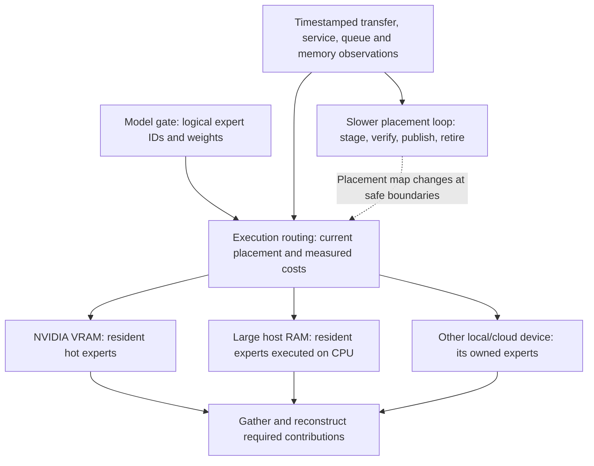

# Capacity first: heterogeneous expert placement and lessons from Colibri

Human clarification, 2026-10-17: the purpose is to make a model runnable across
the combined usable memory of heterogeneous local/cloud devices when no single
device can host it, then find acceptable latency/throughput through measured
placement, execution routing and adaptation. This records research direction;
it does not alter the approved local experiment or start multi-machine/model work.

## The objective that should guide later experiments

1. Find a feasible placement for the chosen model representation, preserving its
   computation contract. A baseline that cannot load the model has no meaningful
   speedup ratio; report feasibility and absolute service quality instead.
2. Make the feasible configuration useful: measure startup/loading, time to first
   token, inter-token latency, throughput and tails at fixed workload/quality.
3. Adapt placement when measured benefits justify it, without destroying capacity,
   inference semantics or outstanding requests.

Every model component needs a home, not only routed experts: attention, routers,
embeddings/output head, shared experts, KV cache, activations, kernel workspaces,
quantization metadata and runtime/OS headroom. Reserve these before admitting
expert bytes. Unified CPU/GPU memory is one physical pool, not two additive
capacities. Discrete VRAM and host RAM require separate tier limits and transfer
costs. A global sum of available bytes is necessary in many placements but not
sufficient: per-host/tier limits, indivisible tensors, topology, workspace and
context length still constrain feasibility.

The current correctness demo retains a full coordinator reference and full tiny
snapshot for checking. It proves tested block-level execution behavior, not an
out-of-core model loader or a model larger than any single host's usable memory.
Later capacity evidence would need owned shard initialization without a hidden
full-model materialization on the coordinator or worker, plus observed per-tier
memory high-water marks (including migration transients). No such result is
claimed now. Kimi K3 is the user's motivating example; no specific model artifact,
precision, context, minimum memory or compatibility is validated by this study.

## Move activations to weights, or weights to compute?

CPU-RAM nodes can hold and execute colder experts. NVIDIA VRAM can hold hotter
experts; a CPU node's resident expert need not first move its weights to a GPU.
The scheduler can send activation rows to that CPU node and receive outputs.
Alternatively it can stage the expert's weights into a GPU tier. These trade
network volume against CPU/GPU service time, queue wait, batch size and reuse.

For illustration only: a hidden size of 8192 in float32 is 32 KiB per input row;
one same-sized output makes 64 KiB round-trip payload per expert assignment,
before metadata. Moving a hypothetical 100 MiB expert instead transfers 1600
times that payload for one row, but the GPU may compute much faster and reuse
the weights across many rows. These numbers describe no inspected model/device.
Model the actual codec, precision, batching and expert footprint before estimating
any real break-even point. Keeping expert IDs and checkpoint bytes unchanged
does not guarantee bitwise agreement across CPU/GPU kernels: each backend still
needs contribution/output checks against the chosen reference and declared
tolerances. Preserving an already quantized checkpoint is also different from
proving equality to its full-precision model.

The following is a proposed architecture, not an executed deployment:

## Primary Colibri source inspected

Identified repository: https://github.com/JustVugg/colibri. It matches the described
disk-streamed MoE engine and learning cache. Pinned revision:
`e0db083cdc9e563e0766cc6fc661ef23c32298e0`, observed 2026-10-17. Similar names
and forks were not combined into this source. See `colibri-source-manifest.json`
for selected-file hashes. This is static primary-code/document inspection: no
Colibri build, tests, model download or model benchmark was run. Instructions in
upstream setup docs were treated as source text, not commands to execute.

All links below are to that pinned revision:

| Finding | Primary source | Research implication |
| --- | --- | --- |
| Hot/warm/cold VRAM/RAM/disk planning; reserve dense/KV/workspace and inspect resource limits | [resource_plan.py](https://github.com/JustVugg/colibri/blob/e0db083cdc9e563e0766cc6fc661ef23c32298e0/c/resource_plan.py), [tuning.md](https://github.com/JustVugg/colibri/blob/e0db083cdc9e563e0766cc6fc661ef23c32298e0/docs/tuning.md) | Colibri also solves capacity through backing storage; disk is a memory tier, not a reason to dismiss the approach |
| Persist actual routed-expert usage and use history for pinning; separate session heat/recency for live replacement | [route_trace.h](https://github.com/JustVugg/colibri/blob/e0db083cdc9e563e0766cc6fc661ef23c32298e0/c/route_trace.h#L314), [colibri.c repin_pick](https://github.com/JustVugg/colibri/blob/e0db083cdc9e563e0766cc6fc661ef23c32298e0/c/colibri.c#L9741), [tier.h](https://github.com/JustVugg/colibri/blob/e0db083cdc9e563e0766cc6fc661ef23c32298e0/c/tier.h#L40) | Learn which experts this workload actually needs; placement can change without changing gate decisions |
| Session LFRU score = `256*heat + max(255-age,0)`; promote only above old score +25% +1024; halve session heat at a repin pass | [tier.h](https://github.com/JustVugg/colibri/blob/e0db083cdc9e563e0766cc6fc661ef23c32298e0/c/tier.h#L40), [repin implementation](https://github.com/JustVugg/colibri/blob/e0db083cdc9e563e0766cc6fc661ef23c32298e0/c/colibri.c#L9848) | Frequency, recency, forgetting and hysteresis address different adaptation problems; a frequency-only global history can become stale |
| Tune real execution settings, compare fixed work/output, require gain and recheck winner before a later baseline | [autotune.py](https://github.com/JustVugg/colibri/blob/e0db083cdc9e563e0766cc6fc661ef23c32298e0/c/autotune.py#L413) | Keep hardware calibration separate from routing-demand history; avoid declaring cache warming a scheduling win |
| Persistent TCP expert-worker mode, keeping generation/routing/KV at coordinator | [cluster.md](https://github.com/JustVugg/colibri/blob/e0db083cdc9e563e0766cc6fc661ef23c32298e0/docs/cluster.md), [cluster_moe_batch](https://github.com/JustVugg/colibri/blob/e0db083cdc9e563e0766cc6fc661ef23c32298e0/c/colibri.c#L3414) | Colibri is already a direct architecture comparator for remote expert execution, not only a disk-streaming alternative |
| Cache-resident selection and prefetch are different levers | [CACHE_ROUTE.md](https://github.com/JustVugg/colibri/blob/e0db083cdc9e563e0766cc6fc661ef23c32298e0/docs/CACHE_ROUTE.md), [tuning.md](https://github.com/JustVugg/colibri/blob/e0db083cdc9e563e0766cc6fc661ef23c32298e0/docs/tuning.md) | CACHE_ROUTE can change expert IDs; PILOT prefetch and exact-replica placement need not. Keep approximation out of the strict-parity lane |

### What “gets better over time” actually means

There are at least three distinct mechanisms:

- **Warm cache:** previously loaded bytes remain available. This can improve a
  repeat without learning any better policy.
- **Demand adaptation:** `.coli_usage` records expert selection; live session heat
  and recency drive repinning. This is placement adaptation, not training model
  weights. The shared history implementation defaults to no persistent decay,
  but `COLI_USAGE_DECAY` optionally decays counters on save. Docs saying persistent
  history is never decayed describe the default, not every supported setting.
- **Hardware tuning:** `autotune.py` tries execution settings and persists a
  model/engine/hardware-fingerprinted result. That fingerprint uses artifact
  identity metadata such as size/mtime, not a content hash of all model weights
  or the engine. Its default minimum gain is 3%;
  gates allow at most .5 percentage-point hit-rate loss and 20% TTFT/p99 regression
  when those metrics are present. Missing metrics do not establish those checks:
  `_safety_gates` treats unavailable values as non-blocking. It rechecks the winner
  before a later baseline; fixed greedy output drift disqualifies candidates in
  the serving path. This is finite-workload evidence, not a universal quality or
  speed guarantee.

More history does not guarantee monotonic improvement. Workloads change; pinning
can overfit prompts; migrations consume bandwidth and temporarily duplicate
weights. Evaluate learned policies on held-out workloads and workload switches,
with identical initial cache/history and both cold/warm states reported.

Two code/doc differences matter: tuning prose mentions a four-swap repin bound,
but the inspected GLM `repin_pass` calls `repin_pass_limit(m,16)`; other call sites
pass other limits. The CUDA-specific promotion branch uses a separate `hh>ch+1`
comparison. Do not describe the documented four-swap/25%-margin policy as a
universal bound over all current branches.

### What its cluster path currently does, in the inspected GLM source

`cluster_moe_batch` maps an expert to worker `(expert_id + layer) % worker_count`.
It groups routed batch rows by expert; each request can contain multiple expert
items. It sends input rows, receives **unweighted** expert outputs, then applies
gate weights and reconstruction at the coordinator. Our TCP demo instead returns
weighted contributions and validates them independently. These are alternative
placements of the weighting operation, not evidence of an arithmetic disagreement.

The inspected coordinator loop sends to a worker and reads its response before
advancing to the next worker; it is not a measured-link-aware parallel fan-out
scheduler. The worker allocates one cached expert slot per layer, loading misses
from model storage, and follows the CPU expert path in this entry point. The
cluster guide asks workers to have the same converted model available locally.
Therefore this source does not establish distributed GPU residency, disjoint
model-file capacity, adaptive link scheduling or aggregate all-RAM hosting.
Registration/heartbeat discovery in `c/cluster.py` is not such a scheduler.

The repo contains tiny-fixture local-versus-delegated parity tests and protocol
tests, including `test_cluster_sharding.py`; those are inspected test definitions,
not test results we ran. Do not transfer their claimed acceptance to our code,
or our bounded-loopback protocol guarantees to theirs. No full protocol/security
audit was performed here.

## Useful combinations to investigate, with separate evidence gates

| Question | Comparison / evidence needed | State here |
| --- | --- | --- |
| Does sharding make the model fit where each host alone fails? | Per-tier budget ledger and peak resident bytes, expert coverage, dense/KV/workspace placement, no hidden full bank | Research design only; tiny demo does not prove this |
| When should CPU-resident execution beat staging to GPU? | Same logical expert/output contract; measured input/output and weight bytes, CPU/GPU service, queues, directional transfer distributions; prefill/decode separately | Proposed comparison, no measured hardware data |
| Is learned placement better than fixed owners? | Replay identical past-only observations; compare fixed, frequency-only, decayed recency/frequency, and cost-aware policies; retain migration bytes and failures | Proposed simulation extension, not implemented |
| Does hot expert promotion repay movement cost? | Estimated future uses * saved critical-path time versus staging/migration/eviction costs; hysteresis/cooldown, transient memory and contention | Proposed cost model; no asserted optimum |
| Do replicas help enough to justify lost capacity? | Count unique covered expert bytes separately from replica bytes; reserve coverage, then test replication benefit at fixed memory | Research constraint; no replicas added to product |
| How does link knowledge change decisions? | Timestamp/age, direction, payload size, concurrency, queue depth, separate service/queue wait and uncertainty; stale/held-out traces | Existing sketch only assumes bandwidth errors; no link measurement yet |

HetRoute offers a joint routing/placement cost framework; Colibri offers concrete
residency, telemetry, safe mutation and tuning mechanisms. Faster links enlarge
the useful placement space but do not replace memory feasibility or scheduling.
The combination worth studying is **feasible distributed residency + measured
execution choices + slower, cost-aware adaptation**, with fixed gate/weight
semantics first. That is a research synthesis, not an implementation claim.

Any later migration needs a versioned placement map: reserve destination space,
transfer the exact shard, verify identity/digest/readiness, publish the new mapping
at a safe boundary, and retire the old copy after in-flight users finish. Count
both copies during the transition. This is a proposed invariant, not existing
SPOJ migration functionality. Retain original native Mac acceptance; no machines,
checkpoints, full-model generation, #2 benchmark work or merges were performed.
