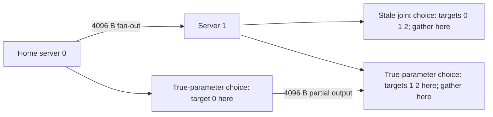

# One observed synthetic routing decision

This walkthrough uses **executed simulator output**, not measured sockets,
models or devices. Raw input/decision/phase values are in
`online-results.json`, `one_bounded_trace`, snapshot **6** of seed **1907**.
Read `primary-analysis.md` for source equations, adaptations and exclusions.

## Follow the decision

One token needs targets 0, 1 and 2; each has an assumed identical full-precision
copy at each of three virtual servers. Home is server 0. Input and each
participating server's output are 4096 bytes. Queue and admission state are
separate FLOP quantities. The only mistaken observation is directed bandwidth
**0→1**: perceived **500,000 B/s**, synthetic truth **5,000,000 B/s**.
The reverse direction remains 1,000,000 B/s.

On the stale snapshot, exact search and width-8 beam both select `(1,1,1)`:
all three targets execute at server 1, which also gathers. It has 900,000 FLOPs
of target work plus 500,000 FLOPs backlog at 30,000,000 FLOPs/s, and 1,000,000
bytes of cold weights at 200,000,000 B/s. Compute/load is therefore
`1,400,000 / 30,000,000 + 1,000,000 / 200,000,000 = .0516666667 s`.
Fan-out is perceived `.008192 s`, actually `.0008192 s` within the synthetic
model. Fan-in is zero because all work and aggregation are co-located.

| Decision policy | Target→server tuple | Gather server | Predicted ms | Same decision at synthetic truth, ms |
| --- | --- | ---: | ---: | ---: |
| Exact, true parameters | (0,1,1) | 1 | 49.971733 | 49.971733 |
| Exact, stale parameters | (1,1,1) | 1 | 59.858667 | 52.485867 |
| Beam width 8, stale parameters | (1,1,1) | 1 | 59.858667 | 52.485867 |
| Per-target greedy, stale parameters | (0,1,1) | 0 | 60.621333 | 53.248533 |

The true-parameter and greedy routes select the **same expert servers**, but
different gather destinations because their information differs. Re-evaluating
the stale route must retain its selected gather destination. Re-selecting it
with true parameters would leak oracle information and understate perception
error; a dedicated test rejects that behavior.

This diagram illustrates the observed synthetic routes above; the arrow labels
are model byte sizes, **not observed TCP messages**:



## Code map and what checks establish

| Code boundary | Meaning | Evidence |
| --- | --- | --- |
| `feasible` | Adds current targets' FLOPs per touched server before checking its window capacity | Two individually fitting targets can fail jointly; an unrelated overloaded server cannot block an otherwise valid route |
| `evaluate` | Eq. (11) sum-gather choice; Eq. (10) three phase maxima with declared co-location sum extension | Hand arithmetic for cold weights, queue counted once, shared-server work, directional links, sum-versus-max gather and phase barriers |
| `exhaustive` | Enumerates the eligible Cartesian product with joint admission | Independently written finite objective/guard matches on 50 seeded snapshots |
| `beam` and `refine` | Fixed target order, total partial-cost ranking; then feasible strict improvement to a 1-exchange fixed point | Full-width equality on tiny domains; all feasible one-target neighbors checked on seeded outputs |
| `run` | Same inputs per policy; stale information at selection; fixed decision evaluated at synthetic truth | Deterministic full-JSON rerun and fixed-gather regression |

An independent finite formula checks the implemented interpretation, not the
paper's empirical accuracy or a hardware scheduler. The 100 snapshots are a
small exploration, not a representative workload: 99 feasible, one jointly
infeasible; all policies complete those 99, with no search failures in this
sample. Width 8 has zero observed cost misses against perceived-parameter exact
search here; this is **not** a general optimality result.

`beam-counterexample.json` retains snapshot 19: width 1 plus converged
1-exchange returns `(0,1,1)`, **91.1648 ms**, while exhaustive search returns
`(1,1,0)`, **81.1648 ms**, under perceived parameters. A one-target local optimum
can require a multi-target move to improve. A separate hand case makes a narrow
beam discard the only prefix that leads to a feasible completion. Both tests
pass by exhibiting the heuristic's limitations, not by making it always succeed.

The aggregate JSON uses a **signed gap** to exact assignment search with the
true-parameter Eq. (11) gather heuristic. That comparator does not optimize all
possible gather destinations for Eq. (10); a stale choice could in principle
beat it. Gap sums include only completed snapshots and retain their denominators
and infeasible/search-failure counts. They are not physical speedup or
nonnegative global regret metrics.

## Reproduce without a model or network

From repository root using Python 3.12 (stdlib only):

```sh
python3 -m unittest discover -s research/heterorouter -p test_online_sketch.py -v
python3 research/heterorouter/online_sketch.py > /tmp/online-results.json
python3 -c 'import json; assert json.load(open("/tmp/online-results.json")) == json.load(open("research/heterorouter/online-results.json"))'
```

Before planning any real routing integration, establish what past-only
measurements can identify: directional payload bytes and transfer duration,
RTT separately from throughput, device service time separately from queue wait,
sample age/uncertainty, and which resources share capacity. Then ask whether the
model predicts held-out traces. No estimator or real measurement is implemented
in this sketch, and no additional machine is needed for this exploration.
