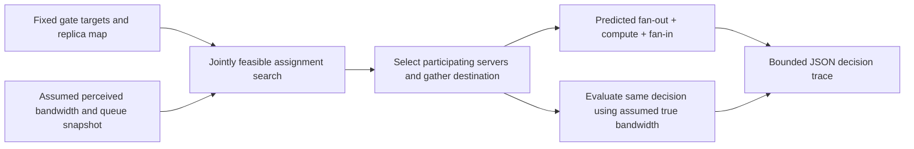

# HetRoute: primary-source reading and bounded online sketch

## Source and scope

Read 2026-10-17 from the user-attached **15-page PDF**, SHA-256
`2ee21d03af26bbeeecb64c4dc7c76eb082b3a40e0ad708fecdf48bf00a65c321`,
3,077,989 bytes. Citation: https://arxiv.org/abs/2608.00577.
The attachment has no verified arXiv version suffix; PDF metadata creation date
2026-08-12 is not proof of an arXiv revision or publication date. All page numbers
below are printed PDF pages. Read using `pdftotext -layout`; page 5 equations
were also inspected visually. No author implementation or raw evaluation data
has been obtained. The attachment is the source, not a secondary summary.

Its title is **HetRoute: Heterogeneous and Cost-aware Collaborative Routing
Framework for Distributed Edge MoE Inference**. Page 1 lists **Xin Yuan, Ning Li,
Wenchao Xu, Song Guo, Haijun Zhang**. The earlier six-author metadata mirror
differs from this attachment; preserve it as historical discovery evidence,
not the attachment's author list. The PDF retains an IEEE template header,
placeholder footnote language, and incomplete baseline citations. These are
provenance/reproducibility caveats, not grounds to dismiss the algorithms.

## What the paper computes

The gate chooses logical target experts. Routing chooses a physical replica
and server per target, possibly a different expert under the substitution policy.
Placement, residency, precision and runtime routing are different variables.

| Contract | Primary reference | Consequence |
| --- | --- | --- |
| Server placement x, GPU/CPU residency y, replica precision c; directional link B, GPU FLOPs/s F, host transfer bytes/s beta | pp. 4–5, III-A/B | Presence does not mean GPU residency or identical precision |
| Exact candidates first; substitutes only when no admissible exact candidate survives | p. 4 Eq. (5), p. 8 V-A | Not arbitrary rerouting among logical experts |
| Quality increment = profiled replica quantization loss + substitution loss | p. 5 Eqs. (8–9) | Additive calibration surrogate, not numerical parity or a per-token empirical accuracy guarantee |
| Assignment cost = incoming bytes/B + cold-weight bytes/beta + (expert FLOPs + queue FLOPs)/F + lambda_q * quality | p. 5 Eq. (9) | Queue and service must have compatible units; RTT is absent from this formula |
| Layer delay = max fan-out + max compute/offload/queue + max fan-in | p. 5 Eq. (10) | Three phase barriers; neither sum of independent costs nor max of end-to-end branch times |
| Aggregator chosen among participating servers by SUM gather time + next-layer lookahead | p. 5 Eq. (11) | Gather selection uses a different objective from layer fan-in MAX; zero lookahead is explicitly allowed |
| Hard quality guard; normal per-window FLOP admission guard | p. 8 Eqs. (18–19) | Individually admissible choices may still conflict jointly |
| Full-precision exact replica invariant; emergency fallback relaxes normal stability, keeps zero quality increment | pp. 6, 8–10, c.4/Property 1 | Quality-safe queue admission is not a finite delay, reachability or stability guarantee |

Strict HF contribution/output equality belongs to correctness PR #6. The paper's
quantization/substitution choices cannot inherit that contract. Even identical
replica scheduling here executes no tensor computation, so this sketch establishes
no numerical equality either.

## Algorithms, before adaptations

**Offline Algorithm 1** (p. 7, Table I; explanation pp. 7–8): start with a
full-precision fallback deployment; simulate the online router on calibration
traffic to estimate conditional replica-selection probabilities. Score residency
by `activation_frequency * selection_probability * weight_bytes / beta`
(Eq. 13). Greedily promote fitting replicas. Add a replica/precision when expected
assignment-cost reduction minus memory price is positive (Eq. 14), within memory
and replication caps. Recompute residency with a diminishing-returns guard that
compares duplicate residency against unserved distinct experts. This is a heuristic,
not a joint placement optimum. Calibration simulation, precision profiles, initial
placement and recomputation decisions are essential inputs, not free observations.

**Online Algorithm 2** (p. 9, Table II; pp. 8–11): construct/prune exact candidates,
activate/prune substitutes only if exact candidates are empty; optionally take a
provably dominating local GPU fast path; otherwise search complete top-k
assignments by exact enumeration or a width-B beam using negative marginal layer
delay (Eq. 20), followed by feasible improving single-target exchanges. Choose the
aggregator, scatter/compute/gather, update quality/backlog, then adapt component
prices via the projected feedback Eq. (21). The small-domain exact result is only
per-layer under current state; beam has no claimed global approximation ratio.
Finite strict descent gives 1-exchange local optimality if refinement actually
runs to convergence.

## Gaps requiring explicit choices

1. **Co-located compute:** Eq. (10) maximizes over servers but retains a single
   executed-expert symbol; it does not state how several targets on one GPU add
   work/offload. Page 8 says those targets compete. Our sketch explicitly sums
   per-target work and cold loading on each server, with queue counted once.
   This is an extension resolving an underspecified case, not verbatim Eq. (10).
2. **Admission/fallback:** pruning each candidate using the old quality/load state
   does not ensure a complete set fits joint budgets. If all individual sets are
   nonempty but no joint assignment fits, Table II's fallback loop over targets
   with *empty* sets provides no explicit repair. Its proof does not resolve this
   case. Nor does placement alone imply network reachability under failures.
3. **Search threshold:** Table II compares a server-domain cardinality with a
   power of average replica count; Property 3 uses a candidate-product bound
   that is not implied by that test. Evaluation p. 11 instead specifies **64
   candidate assignments**. Use an actual product count in any automatic selector.
4. **Search scoring/ties:** Eq. (20)'s marginal score is not a complete beam
   specification: ranking incremental changes across different parents versus
   accumulated scores can differ. Target ordering, ties and empty-beam handling
   need choices. Re-evaluating Eq. (11) can change the aggregator discontinuously.
5. **Cost/quality weights:** Eq. (9) has lambda_q; Eq. (10) optimizes delay, while
   Table II inputs adaptive alpha components and Eq. (21) updates them without a
   fully specified insertion into Eq. (10). Several equation/line cross-references
   are stale. We do not invent a weighted objective and attribute it to the paper.
6. **Complexity:** p. 11 assumes O(1) incremental scoring and constant exchange
   sweeps. Recomputing coupled aggregation is not generally O(1), and a constant
   sweep cap does not guarantee exchange local optimality. A simple reference
   implementation should report its actual work instead of adopting this bound.

## Evaluation: what we can and cannot verify

Section VI p. 11 reports a PyTorch trace-driven ten-server edge testbed with
18–120 TFLOPS, 12–48 GB GPU memory, 96–512 GB CPU memory, 12–64 GB/s
GPU–CPU transfer, 0.8–10 Gbps links, 0.3–22 ms propagation-plus-queue delay,
default 40 requests/s, width 8 and 64-assignment enumeration threshold.
Three named models and WikiText-103/SQuAD/GSM8K are reported. These are author
reports; we have not run them or acquired their traces. The equations omit an
explicit propagation term despite the evaluation describing it. The provided
setup does not supply enough immutable model/data/software/hardware revisions,
arrival traces, estimator details, baseline configurations or raw trial outputs
to independently reproduce the headline results here. Our simulation does not
confirm or refute those measured claims.

## Executable subset

`online_sketch.py` implements one **synthetic, fixed-deployment, full-precision,
exact-replica, single-layer** decision boundary. Quality is identically zero.
No offline optimization, substitutions, precision selection, local fast path,
emergency fallback, price feedback, trajectory planning, actual transport or
model inference is implemented. Infeasibility is reported; it is not silently
turned into a successful route. The original `simulate.py` remains a separate
generic queue/calendar bootstrap, not this paper-derived sketch.

Inputs are assumed directional bandwidths, service/transfer rates, replica
residency/footprints, current queue FLOPs and per-window admitted FLOPs. A stale
bandwidth observation is a hypothetical perception error, not a network sample.
Every selected route is evaluated unchanged against the same synthetic true
snapshot, preserving its chosen aggregation server. No decisions learn future
truth. Queue snapshots do not evolve into a multi-request simulation.

The aggregation rule is Eq. (11), zero lookahead, ties by server ID. Cost is the
three-phase Eq. (10) with the documented per-server sum extension. Exact search
uses the whole Cartesian product and joint workload admission. Beam target order
is fixed; partial scores use the full current partial-set cost (accumulated
negative marginal improvements), ties by assignment tuple. Width 8 is from the
paper's evaluation; it is not asserted optimal. Feasible 1-exchange refinement
runs until no strict improvement remains. This implementation favors inspectable
reference logic over speed.

The following is an **explanatory flow**, not an observed network trace:

The original disjoint-owner correctness workers have no replica-selection choice.
This separate hypothetical placement must not be inserted into that implementation
without a new explicitly authorized design/task.
