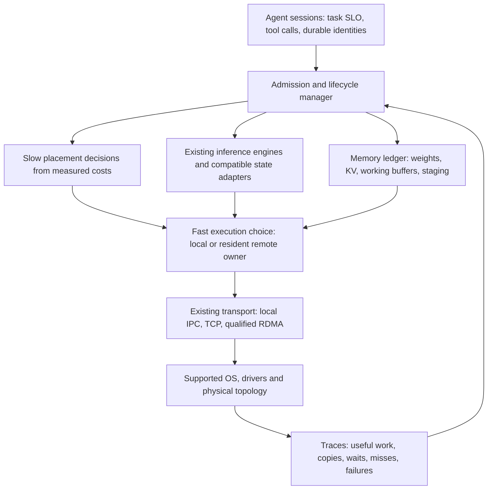

# Design around resident state and the token's critical path

**Recommendation: investigate computation placement and existing inference
runtime policies before buying faster links or writing a new OS.** Hardware
capacity determines what can run; local memory bandwidth, compute and the
number/size of remote dependencies determine how fast it can run. There is no
general rule that networking matters more than the GPU.

This is a proposed research architecture under issue #9, not an approved product
specification. The user offered hardware access; exact machines/model/task remain
unavailable at publication. Two experiments and a primary-source review were
completed locally. No physical GPU/NIC/optical link or real inference ran here.

## What we learned from the two experiments

### 1. Transfer granularity changes the design

The [preregistered architecture calculation](PROTOCOL.md) evaluates 1,620 assumed
cases. For its explicit MoE geometry, one cold layer needs **168 MiB** of selected
4-bit expert weights, versus **16 KiB** for an activation request and fused result.
That is a **10,752-fold payload difference**, not an inference speedup. Scales,
metadata and packing are omitted, favoring the weight-staging baseline.

We compare an optimistic fully pipelined weight path with a serialized remote
compute path, rather than handicapping the baseline with unnecessarily separate
expert requests. Examples below assume 32 layers, 0.1 ms dense GPU work/layer,
0.2 ms GPU expert work/layer,2 ms CPU expert work/layer,80% line efficiency,
24 GB/s GPU PCIe payload rate, one active flow,0.2 ms RTT. These numbers are
**scenario inputs, not measurements or predictions**:

| Cold layers per token | Link | Staged weights, optimistic–serial | Near-weight CPU, serialized | Full-GPU reference if it fits |
|---:|---:|---:|---:|---:|
| 0 | Any | 9.6 ms | 9.6 ms | 9.6 ms |
| 4 | 10 Gb/s | 714.2–744.4 ms | 17.67 ms | 9.6 ms |
| 4 | 100 Gb/s | 80.1–110.2 ms | 17.61 ms | 9.6 ms |
| 32 | 10 Gb/s | 5,646.7–5,888.0 ms | 74.15 ms | 9.6 ms |
| 32 | 100 Gb/s | 573.3–814.6 ms | 73.67 ms | 9.6 ms |

For the near-weight path here, the tenfold link upgrade barely helps because
CPU service and dependent RPCs dominate. For repeatedly moving weights, it helps
a great deal but still loses to moving the much smaller activations under these
assumptions. With everything resident on the GPU, changing the link does nothing
to this token path. A slower CPU, a faster memory fabric, different kernels,
smaller cold experts or stronger cache reuse can reverse the tradeoff.

The grid has 1,248 conditional near-weight wins at the 20% latency-screening gate,
372 cases without a robust winner and zero robust weight-staging wins. The chosen
geometry and rates strongly shape that outcome; counts are **not probabilities**
or evidence that every real workload should use a CPU donor. Both physical fit
and numerical correctness remain unverified in every row.

Coarse contiguous layers reduce repeated synchronization: with 32 remote layers
and 1 ms RTT, the assumed near-expert path takes 99.27 ms, whereas the separately
modeled coarse remote block takes 81.00 ms despite extra CPU dense work. That design
also moves KV/attention and whole-layer residency to the donor; it is **not** a
matched drop-in optimization or a proven supported engine configuration. The
model covers layer-body costs, not tokenizer, embedding/head or application costs.

Batch-1 decode, prefill and batched throughput must be tested separately. If B
tokens use identical resident experts, weights can be reused while activation
bytes grow with B. Real expert unions and routing imbalance complicate this;
the single-token grid cannot predict the batched crossover. Long-context KV
reads can also dominate even when weights fit. Remote attention is a separate
algorithm, not ordinary remote RAM reads disguised by a cable.

### 2. Local transport does not yet justify an OS rewrite

The actual [C transport experiment](transport/RESULTS.md) ran 1,520 verified
request/echo exchanges in five paired TCP-loopback/Unix-domain process sessions.
It sent 90,117,376 application bytes including warmups and a deliberately corrupted
reply. All positive exchanges passed and corruption failed with the expected
exit 42. Strict compilation initially failed; failure and targeted fix are retained.

For 128-byte payloads, within-session medians ranged 14.05–21.41 us for TCP and
11.02–15.39 us for Unix sockets. However, **the apparent winner reversed with
execution order** for the small payloads. This shared-VM result establishes no
stable transport advantage, no NIC bandwidth and no inference bottleneck.
Connection setup, default buffer differences, CPU placement, verification and
scheduling are explicitly recorded or disclosed. No localhost measurement is
substituted into the physical-link cost grid.

The OS arithmetic has a clear falsifier: if only 5% of the real critical path is
removable OS work, a perfect replacement saves at most 5% latency (1.053x speedup).
A 20% latency reduction requires at least 20% truly removable time with perfect
elimination, or 40% if only half is removed. These are assumed fractions, not
profiled measurements; mean fractions cannot be applied blindly to p99.

## Hardware design: choose the traffic and topology first

Fiber does not turn machines into a coherent shared-memory GPU. Keep four layers
separate: physical medium (DAC/AOC/fiber), link/NIC protocol, PCIe/DMA/memory path,
and the inference scheduler's message/placement choices. Upgrading one layer
does not remove the others' limits.

The [primary-source packet](sources/REPORT.md) records nominal H100 SXM HBM
3,350 GB/s versus 400 Gb/s networking's 50 GB/s raw byte-rate ceiling: a 67x nominal
bandwidth gap, **not a speed ratio**. NIC rate is not attained payload bandwidth.
GPU/NIC root-complex placement, negotiated PCIe width, host memory bandwidth,
driver support, flow contention and synchronization all need measurement.
GPUDirect RDMA is a supported DMA mechanism, not a guarantee for arbitrary GPUs
or coherent memory. An optical connection is useful for compatible link speed,
reach and layout; at the same negotiated rate it is not automatically faster
than a suitable short direct cable.

Use at most these three lab configurations, selected from available hardware:

| Lab | Hardware role | Decisive comparison |
|---|---|---|
| One-host reference | Existing GPU/VRAM or unified-memory host, enough RAM/storage for the authorized artifact | Same model local: fit, warm/cold load, prefill, decode, KV pressure, two-session agent workload |
| Two compatible TB5 Macs | Existing supported Macs, direct suitable cable, pinned MLX/JACCL and OS versions | One node versus distributed; JACCL versus documented TCP baseline, small collective latency and large payloads |
| Two Linux hosts | GPU host plus RAM-rich CPU donor; if available, second GPU and qualified 25/100 GbE or RDMA NICs on suitable PCIe paths | Execute near donor weights versus stage them; coarse layers versus fine RPCs; host-staged versus supported GPU-direct paths |

These are proposed roles, not a bill of materials or purchase recommendation.
For short two-node tests, a compatible direct link avoids an extra switch as a
confounder; later test the actual intended switch/network topology. Check NIC
SKU/firmware, cable/module compatibility and negotiated rates before interpreting
results. A switch can add queueing/contention even when nominal speed matches.

MLX's current guide/configuration helper documents direct full-mesh JACCL setup;
earlier pinned lower-level code also supports a ring. The packet preserves that
version/layer distinction. Do not assume mixed Apple/CUDA collective execution
or that a USB-C connector establishes RDMA. No Mac configuration was performed.

The hardware inventory must capture CPUs/NUMA/channels/DIMM population, GPU/VRAM,
RAM and swap, PCIe root/slot/link state, NIC/firmware and switch, cable/module,
storage/filesystem, power limits, drivers/OS and allowed existing model artifacts.
Usable capacity subtracts dense weights, KV, allocator/workspace, transfer staging
and OS reserves. On unified memory, count physical RAM once. A model fitting
across two machines can be valuable even when it is slower than a hypothetical
single device with enough memory.

## Software design around an agent workload

Build a small userspace resource manager around an existing engine first. This
is a research proposal, not a newly implemented scheduler:

The manager sees prefill, decode, idle/tool-wait, resume and completion phases.
It should account for actual allocated versus reusable memory, batch only within
latency budgets, keep hot weights and KV near their compute, and adapt placement
slower than per-token routing. Independent requests/agent jobs distributed across
resident engines are the first throughput baseline. Single-token partitioning
is justified by capacity or measured gain, not by the number of available boxes.

Durable tool-call/output identity, ownership and resume state are reused from
the D1/D2 findings; KV alone is not a complete agent checkpoint. Exact model,
tokenizer, backend, quantization and logical expert semantics remain fixed for
comparisons. No opportunistic expert dropping or precision change counts as a
systems speedup under the same-quality contract.

Existing Linux/runtime mechanisms to qualify include NUMA/affinity, preallocation,
supported pinned staging, regional hugepages where useful, asynchronous/pipelined
I/O, existing cache-budget controls, fused requests and supported RDMA. Each can
have CPU, memory, power, compatibility and tail-latency costs. The prior Colibri
D7 packet already covers mmap/directIO/io_uring and cache-retention alternatives.

## When would a fresh OS become a defensible project?

Only after a trace identifies an important bottleneck that existing engine,
userspace and narrowly scoped kernel/driver mechanisms cannot remove. The first
prototype should isolate that one mechanism on an existing host, with unchanged
outputs and an end-to-end metric. A full replacement also needs GPU/NIC/storage
drivers, isolation, tool/process compatibility, telemetry, updates and recovery.
IX is a source-supported specialized dataplane precedent, not LLM evidence.

Possible research targets are explicit memory-lifetime/ownership contracts,
deadline-aware wakeup/batching, fewer copies between owned buffers, or predictable
prefetch and residency. A new syscall or userspace engine extension may suffice.
If math, required bytes, physical memory capacity or hardware synchronization
dominates, a kernel rewrite cannot eliminate that cost. A new OS remains
**UNRESOLVED and currently unjustified**, not disproved for all future workloads.

## Next real experiment and evidence gate

Choose one existing machine/model/task and then add a second machine. Freeze a
recorded task with prefill, decode, tool wait and resume; retain token outputs
and correctness policy. Record per-stage CPU/GPU active time, GPU idle gaps,
memory/copy traffic, actual wire bytes and request count, cache misses, allocated
and reusable KV, energy if metered, failures and complete task latency.

Measure small-message round trips/collectives separately from bulk bandwidth.
Compare strongest applicable one-host, independent-job, resident-remote-expert,
coarse-layer and pipelined-staging paths only where the engine actually supports
them. Declare 20% lower end-to-end latency or useful new capacity within a chosen
task SLO before trials; charge loading/migration/queueing/copies. Require matched
outputs and a separate validator. Stop if existing configuration solves the
problem, the causal overhead ceiling is too small, or gains depend on uncharged
resources/changed semantics. No SLO has yet been approved by the user.

Evidence: [model inputs](inputs.json), [raw model results](evidence/model-attempt-1/grid.stdout),
[execution records](evidence/model-attempt-1/execution.json), [transport results](transport/RESULTS.md),
[primary source provenance/excerpts](sources/public-evidence.json). Independent
review and final handoff are added as separate evidence files after freeze.
Product checks and native-Mac acceptance remain separate gates.
